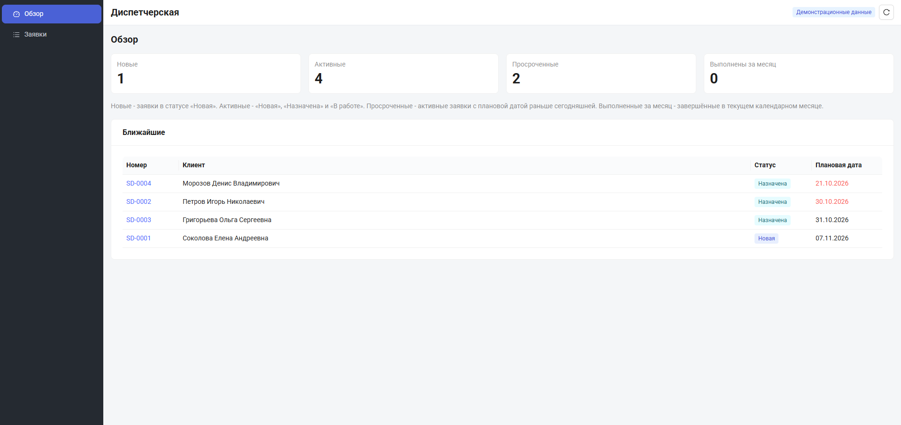
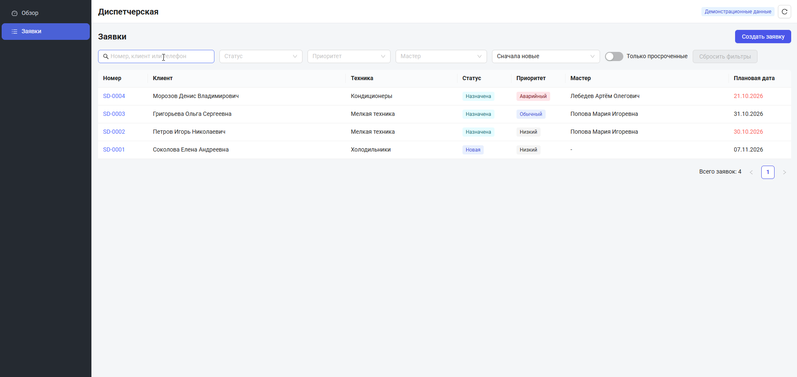
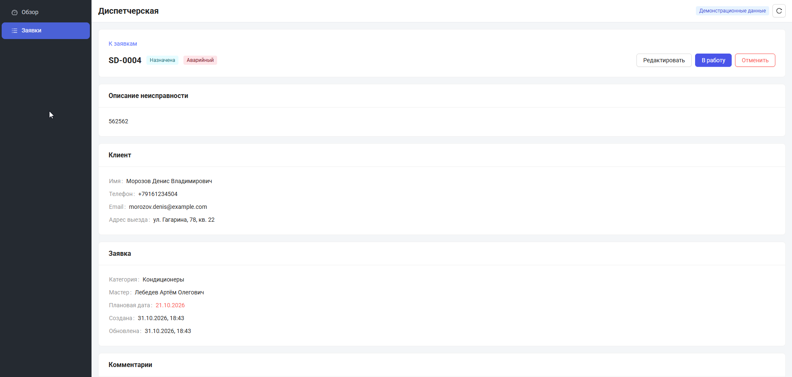
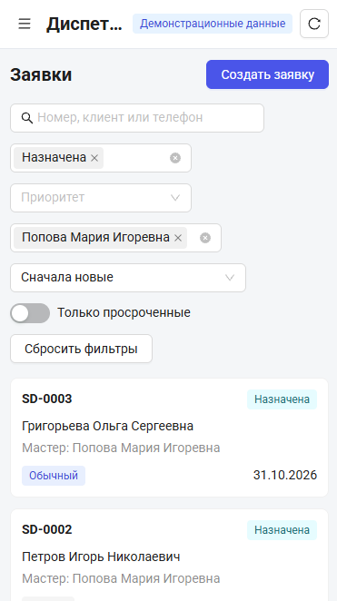

# Диспетчерская (ServiceDesk Lite)

Демонстрационный кабинет диспетчера сервисной компании, которая ремонтирует бытовую
технику: заявки, назначение мастера, переходы по статусам, комментарии и история.

Посетитель за пару минут проходит сценарий: создать заявку → назначить мастера →
начать работу → завершить → увидеть изменения в списке и показателях.



## Стек

- React 19 + TypeScript, Vite.
- React Router: состояние списка живёт в адресе.
- Ant Design с собственной темой и локалью `ru_RU`.
- React Hook Form + Zod: одна схема для формы и слоя данных.
- IndexedDB через типизированный слой: операции, снапшот, экран восстановления.
- Playwright: четыре сценария, прогоняются в двух часовых поясах.
- ESLint и Prettier.

## Запуск

Нужен Node 20 или новее.

```bash
npm install
npm run dev
```

Приложение откроется на `http://127.0.0.1:5173`, стартовый экран — `/overview`.

Сборка и предпросмотр:

```bash
npm run build
npm run preview
```

## Что посмотреть

1. **Обзор.** Четыре показателя: новые, активные, просроченные и выполненные за
   текущий месяц. Три из них ведут в отфильтрованный список.
2. **Список.** Поиск по номеру, клиенту и телефону, фильтры по статусу, приоритету,
   мастеру и просрочке, сортировка, пагинация. Всё состояние живёт в адресе, ссылку
   можно сохранить и открыть заново.
3. **Создание.** Клиент ищется по цифрам телефона; категории без мастера недоступны;
   список мастеров фильтруется по выбранной категории.
4. **Карточка.** Назначение мастера списком, «В работу», «Выполнить» с обязательным
   результатом, «Отменить» с причиной, редактирование полей, комментарии и история
   событий.
5. **Мобильная ширина.** До 768 px таблица превращается в карточки, навигация —
   в выдвижное меню, шапка остаётся в одну строку.

Демо начинается с пустого списка: справочники есть, заявок нет. Кнопка «Сбросить
демо» в шапке возвращает справочники к исходным и обнуляет заявки.

## Скриншоты

Список с фильтрами:



Карточка заявки в работе:



Мобильная версия, 390 px:



## Хранение

Данные лежат в IndexedDB: база `servicedesk-lite`, одна запись `current` со
справочниками и заявками. Компоненты к хранилищу не обращаются — только операции
(`createRequest`, `updateRequest`, `changeStatus`, `addComment`), которые проверяют
zod-схему и инварианты до записи.

Если данные повреждены или версия схемы не совпала, открывается экран восстановления
с предложением сбросить демо вместо белого экрана. Сброс демо — с подтверждением.

## Проверки

```bash
npm run check
npx playwright install chromium
npm test
```

Тесты прогоняются в проектах `yekaterinburg` и `utc`: правило дат проверяется на двух
часовых поясах, чтобы поймать сдвиг на границе месяца. Каждый тест создаёт свои
данные в своём контексте браузера.

## Структура

```
src/
  app/         каркас: провайдеры, роутер, тема, разметка
  pages/       страницы маршрутов
  features/    панели, действия в карточке, комментарии, история, карточки списка
  components/  теги статуса и приоритета
  data/
    model/         типы и чистые функции
    validation/    zod-схемы, инварианты, коды ошибок
    storage/       IndexedDB, снапшот и подписка для React
    operations/    операции изменения данных
    seed/          демо-данные
    request-list.ts, request-list-url.ts, overview.ts - селекторы
    repositories.ts - чтение для интерфейса
```

Направление зависимостей: `model` ← `validation` ← `seed` / `storage` ← `operations`.
Интерфейс общается только с операциями и репозиториями.

## Ограничения

- Backend отсутствует: всё живёт в браузере и между устройствами не синхронизируется.
- Синхронизации между вкладками нет: побеждает последняя запись.
- Прямые ссылки вида `/requests/<id>` на статическом хостинге требуют fallback на
  `index.html`, иначе сервер вернёт 404 — это настройка хостинга, а не приложения.
- Шрифт Roboto загружается с Google Fonts; без сети используется системный набор.
- Заявки в демо-данных не генерируются: первый экран списка пустой осознанно.
